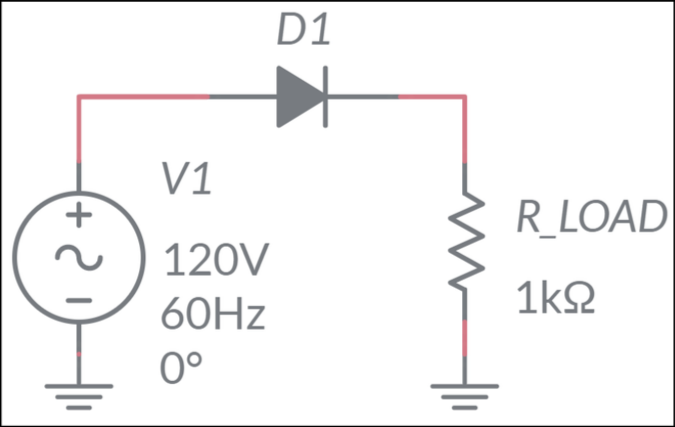

```{=latex}
\frontmatter
```



# Введение

Цель лаболаторной работы -- (i) Изучение теоретических основ и принципов проективания
выпрямительных схем. (ii) Обоснование применения различных типов диодов с проектными 
требованиями. (iii) Объяснение роли транзисторов в схемах усилителей. (iv) Определение
причин некоторых нежелательных поведений полупроводниковых схем. (v) Выбор параметров 
компонентов для достижения желаемых характеристик усилителя.

Оборудование: Плата TI Power Electronics, лаболаторный стенд NI ELVIS III, программное
обеспечение LabVIEW Runtime Engine.



# Теоретические сведения

Выпрямитель тока -- элемент цепи, преобразующий сигнал переменного тока в сигнал 
постоянного тока, ограничивая его так, чтобы был строго выше или ниже опорного напряжения.

{}

Однополупериодный выпрямитель -- схема, пропускающая сигнал через диод, оставляя только 
его составляющую, протекающую в плолжительном направлении. Половина мощности в такой цепи 
теряется, а также в ней проявляются сильные отражения и помехи.
